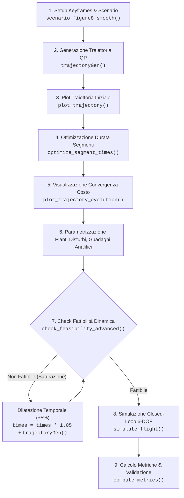
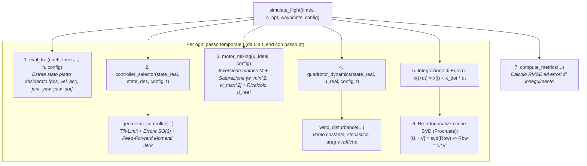

# Architettura e Flusso di Esecuzione del Simulatore (`main.m`)
**Riferimento Teorico:** *Mellinger & Kumar (2011), "Minimum Snap Trajectory Generation and Control for Quadrotors"*

---

## 1. Risposte ai Quesiti Teorico-Implementativi

### Domanda 1: Coefficienti $c$, Ordine del Polinomio ($n$) e Derivata Minima ($k$)
* **Significato dei coefficienti $c$ e indici:**
  La traiettoria dell'uscita piatta $\boldsymbol{\sigma}(t) = [x(t), y(t), z(t), \psi(t)]^T$ è definita a tratti su $m$ segmenti temporali ($j = 1, \dots, m$ delimitati da $M = m+1$ waypoints). Per ciascun asse $\mu \in \{x, y, z, \psi\}$ e per ogni segmento $j$:
  $$P_j(t) = \sum_{i=0}^n c_{i,j} \cdot \left(\frac{t - t_{j-1}}{t_j - t_{j-1}}\right)^i = c_{0,j} + c_{1,j} \tau + c_{2,j} \tau^2 + \dots + c_{n,j} \tau^n$$
  * L'indice **$j$** individua il segmento temporale ($j = 1, \dots, m$), corrispondente alle **righe** delle matrici `c.coeff_*`.
  * L'indice **$i$** individua la potenza del monomio ($i = 0, \dots, n$), corrispondente alle **colonne** delle matrici `c.coeff_*` ($[c_0, c_1, \dots, c_n]$).
* **Distinzione fondamentale tra grado del polinomio ($n$) e ordine della derivata ($k$):**
  * **$k$** è l'ordine della derivata minimizzata nel funzionale di costo quadratico:
    * `k_pos = 4` (**Snap**, 4ª derivata della posizione).
    * `k_yaw = 2` (**Accelerazione angolare**, 2ª derivata dello yaw).
  * **$n$** è il grado del polinomio impiegato. Per garantire la continuità fino alla derivata $(k-1)$-esima su entrambi i confini temporali di ciascun segmento, sono necessarie $2k$ condizioni al contorno per segmento:
    * **Posizione ($k=4$):** Servono $2 \times 4 = 8$ vincoli (posizione, velocità, accelerazione e jerk su inizio e fine segmento). Il polinomio richiede 8 gradi di libertà $\implies$ grado **$n_{pos} = 7$** (8 coefficienti: da $c_0$ a $c_7$).
    * **Yaw ($k=2$):** Servono $2 \times 2 = 4$ vincoli (angolo e velocità angolare su inizio e fine segmento). Il polinomio richiede 4 gradi di libertà $\implies$ grado **$n_{yaw} = 3$** (4 coefficienti: da $c_0$ a $c_3$).
  * La struttura dati in uscita da [`trajectoryGen`](file:///d:/Minimum-snap-trajectory-generation/planning/trajectoryGen.m) è:
    * `c.coeff_x`, `c.coeff_y`, `c.coeff_z`: matrici `[m x (n_pos + 1)] = [m x 8]`.
    * `c.coeff_psi`: matrice `[m x (n_yaw + 1)] = [m x 4]`.
    * `times`: vettore colonna `[M x 1]`.

---

### Domanda 2: Ottimizzazione dei Tempi e Conservazione del Tempo Totale
* **La funzione [`optimize_segment_times`](file:///d:/Minimum-snap-trajectory-generation/planning/optimize_segment_times.m) esegue una ripartizione a tempo totale rigorosamente costante.**
  * Il gradiente numerico perturba la durata $T_j = t_j - t_{j-1}$ applicando una direzione di variazione $g_i$ a somma nulla:
    $$g_i(i) = 1, \quad g_i(k) = -\frac{1}{m - 1} \quad (\forall k \ne i) \implies \sum_{j=1}^m g_i(j) = 0$$
  * Ad ogni iterazione, sia con *Backtracking Line Search* sia a passo fisso, viene applicata la normalizzazione:
    ```matlab
    T_new = T_new * (sum(T) / sum(T_new)); % Preserva T_tot = sum(T) costante
    ```
  * **Confronto con la teoria:** Nel paper (§IV-C) viene considerata sia l'ottimizzazione a tempo fisso sia quella a tempo libero con penalità $\alpha_T \sum T_j$. L'implementazione adotta la formulazione a **tempo fisso**. Il tempo complessivo viene invece allungato (+5%) esclusivamente a valle dal loop di fallback di sicurezza (in [`main.m`](file:///d:/Minimum-snap-trajectory-generation/main.m#L178-L192)) se la traiettoria viola i limiti dei motori.

---

### Domanda 3: Parametri $\zeta$ e $\omega_n$ e Stabilità a Ciclo Chiuso
* **Sono il coefficiente di smorzamento adimensionale ($\zeta$) e la pulsazione naturale ($\omega_n$) del sistema del secondo ordine:**
  $$s^2 + 2\zeta \omega_n s + \omega_n^2 = 0$$
* Vengono impiegati per il **Pole Placement analitico** dei guadagni del controllore, agganciandoli alla fisica reale del drone:
  * **Outer Loop (Posizione / Traslazione con massa $m$):**
    $$\mathbf{K}_p = m \cdot \omega_{n,pos}^2 \cdot \mathbf{I}_{3\times 3}, \quad \mathbf{K}_v = 2 m \zeta \omega_{n,pos} \cdot \mathbf{I}_{3\times 3}$$
  * **Inner Loop (Assetto su $SO(3)$ con matrice d'inerzia $\mathbf{J}$):**
    $$\mathbf{K}_R = \mathbf{J} \cdot \omega_{n,att}^2, \quad \mathbf{K}_\omega = 2 \zeta \omega_{n,att} \cdot \mathbf{J}$$
  * Con $\zeta = 1.0$ si ottiene lo **smorzamento critico** (massima rapidità di tracking senza oscillazioni né overshoot).
  * La separazione in frequenza ($\omega_{n,att} = 15 \text{ rad/s} \gg \omega_{n,pos} = 3 \text{ rad/s}$) garantisce la separazione delle scale temporali: l'assetto converge molto prima della posizione, requisito essenziale per la stabilità asintotica del quadrirotore.

---

## 2. Diagramma del Flusso Operativo (`main.m`)



---

## 3. Tabella Sinottica delle Funzioni Principali

| Fase | Funzione Invocata | Input Principali | Output Restituiti | Descrizione / Ruolo |
| :--- | :--- | :--- | :--- | :--- |
| **Scenario** | [`scenario_figure8_smooth`](file:///d:/Minimum-snap-trajectory-generation/scenarios/scenario_figure8_smooth.m) | Nessuno | `waypoints` $[M \times 4]$, `times` $[1 \times M]$, `config_scenario` | Genera l'anello 3D a 8 e i parametri dei Safe Corridors. |
| **QP Plan** | [`trajectoryGen`](file:///d:/Minimum-snap-trajectory-generation/planning/trajectoryGen.m) | `times` $[1 \times M]$, `waypoints` $[M \times 4]$, `config` | `c` (struct con matrici dei coeff.), `total_cost` (scalare) | Risolve il problema quadratico con vincoli di continuità e corridoio. |
| **Plot 1** | [`plot_trajectory`](file:///d:/Minimum-snap-trajectory-generation/visualization/plot_trajectory.m) | `waypoints`, `times`, `c_init`, `config` | Figure MATLAB | Visualizza curva 3D e profili temporali di pos, vel, acc, jerk, snap. |
| **Time Opt** | [`optimize_segment_times`](file:///d:/Minimum-snap-trajectory-generation/planning/optimize_segment_times.m) | `times`, `waypoints`, `config` | `times_current` $[1 \times M]$, `c_current` (struct), `cost_history` | Ripartisce le durate $T_j$ via gradiente con tempo totale costante. |
| **Plot 2** | [`plot_trajectory_evolution`](file:///d:/Minimum-snap-trajectory-generation/visualization/plot_trajectory_evolution.m) | `waypoints`, `times`, `c_init`, `times_current`, `c_current`, `config` | Figure MATLAB | Confronto prima/dopo l'ottimizzazione temporale. |
| **Check** | [`check_feasibility_advanced`](file:///d:/Minimum-snap-trajectory-generation/planning/check_feasibility_advanced.m) | `times_current`, `c_current`, `config` | `is_feasible` (booleano) | Verifica saturazione RPM motori tramite inversione della dinamica esatta. |
| **Flight** | [`simulate_flight`](file:///d:/Minimum-snap-trajectory-generation/simulation/simulate_flight.m) | `times_current`, `c_current`, `waypoints`, `config` | Animazione 3D e telemetria | Esegue il ciclo completo di controllo e integrazione fisica. |
| **Metrics** | [`compute_metrics`](file:///d:/Minimum-snap-trajectory-generation/benchmarks/compute_metrics.m) | `time_history`, `pos_history`, `pos_des_history`, etc. | `metrics` (struct con RMSE, Max Error) | Quantifica tracking di posizione e velocità e rispetto dei vincoli. |

---

## 4. Analisi di Dettaglio: `simulate_flight` e Chiamate Annidate

La simulazione dinamica a ciclo chiuso ([`simulate_flight.m`](file:///d:/Minimum-snap-trajectory-generation/simulation/simulate_flight.m)) avanza con passo discreto $\Delta t = 0.001\text{ s}$ per una durata $t_{end} = t_m$.

### 4.1 Diagramma a Blocchi del Ciclo di Controllo e Simulazione

```mermaid
flowchart LR
    %% STILI
    classDef ref fill:#1f2937,stroke:#3b82f6,stroke-width:2px,color:#fff;
    classDef outer fill:#1e3a8a,stroke:#60a5fa,stroke-width:2px,color:#fff;
    classDef inner fill:#064e3b,stroke:#34d399,stroke-width:2px,color:#fff;
    classDef plant fill:#7c2d12,stroke:#f97316,stroke-width:2px,color:#fff;
    classDef dist fill:#4c1d95,stroke:#a78bfa,stroke-width:2px,color:#fff;
    classDef mixing fill:#374151,stroke:#9ca3af,stroke-width:2px,color:#fff;

    %% 1. GENERATORE DI RIFERIMENTO
    subgraph REF ["1. Generatore Riferimento (Differential Flatness)"]
        ET["eval_traj()<br/><b>Stato Piatto Desiderato</b><br/>p_des, v_des, a_des<br/>jerk_des, yaw_des, yaw_dot_des"]:::ref
    end

    %% 2. OUTER LOOP (POSIZIONE)
    subgraph OUTER ["2. Outer Loop: Controllo di Posizione"]
        ERR_P(("Errore<br/>Pos & Vel"))
        POS_CTRL["Pos PD + FeedForward:<br/><b>F_des = -Kp*ep - Kv*ev + mg*e3 + m*a_des</b>"]:::outer
        TILT["Filtro Tilt-Limit<br/><b>max 45°</b>"]:::outer
        THRUST["Calcolo Spinta Scalare:<br/><b>u1 = dot(F_des, z_B)</b>"]:::outer
    end

    %% 3. CALCOLO ASSETTO SO(3) & INNER LOOP
    subgraph INNER ["3. Inner Loop: Assetto su SO(3)"]
        GEN_R["Generatore Assetto SO(3):<br/><b>z_des = F_des / ||F_des||</b><br/><b>y_des, x_des da yaw_des</b><br/>-> Matrice R_des"]:::inner
        ERR_R(("Errore<br/>R & omega"))
        SO3_CTRL["Controllo Assetto:<br/><b>eR = 1/2(R_des'R - R'R_des)v</b><br/><b>omega_des da Jerk FF</b><br/><b>tau = -KR*eR - Kw*ew</b>"]:::inner
    end

    %% 4. ATTUAZIONE & MIXING
    subgraph ACTUATION ["4. Allocazione Motori"]
        COMB["u_ideal = [u1; tau]"]
        MIX["motor_mixing()<br/><b>omega_sq = M \\ u_ideal</b><br/>Taglio: [w_min^2, w_max^2]<br/><b>u_real = M * omega_sq</b>"]:::mixing
    end

    %% 5. PIANTA DINAMICA & DISTURBI
    subgraph PLANT ["5. Plant Fisico (quadrotor_dynamics)"]
        DIST["wind_disturbance()<br/>Vento costante/random,<br/>Drag puntiforme, Raffiche"]:::dist
        SUM_F(("Somma Forze & Momenti"))
        DYN["Equazioni Newton-Eulero 6-DOF:<br/><b>v_dot = -g*e3 + (u1/m)R*e3 + F_ext/m</b><br/><b>w_dot = J^-1(tau + tau_ext - w x Jw)</b>"]:::plant
        INT["Integrazione Eulero (dt=0.001s)<br/>+ <b>Procruste SVD su R_BW</b>"]:::plant
    end

    %% CONNESSIONI DI FLUSSO FORWARD
    ET -- "p_des, v_des" --> ERR_P
    ET -- "a_des" --> POS_CTRL
    ERR_P --> POS_CTRL
    POS_CTRL --> TILT
    TILT --> THRUST
    TILT -- "F_des" --> GEN_R
    ET -- "yaw_des" --> GEN_R

    GEN_R -- "R_des" --> ERR_R
    ET -- "jerk_des, yaw_dot" --> SO3_CTRL
    ERR_R --> SO3_CTRL

    THRUST -- "u1" --> COMB
    SO3_CTRL -- "tau" --> COMB
    COMB --> MIX

    MIX -- "u_real (u1_real, tau_real)" --> SUM_F
    DIST -- "F_ext, tau_ext" --> SUM_F
    SUM_F --> DYN
    DYN --> INT

    %% FEEDBACK LOOPS
    INT -- "p, v (Stato Traslazionale)" --> ERR_P
    INT -- "R_BW (z_B reale)" --> THRUST
    INT -- "R_BW, omega_BW (Stato Rotazionale)" --> ERR_R
```



### 4.2 Sequenza Temporale delle Chiamate nel Loop



### Dettaglio dei Singoli Moduli Annidati

#### 1. `eval_traj.m` (Campionamento Traiettoria Polinomiale)
* **Scopo:** Localizza il segmento temporale attivo $j$ in cui ricade $t \in [t_{j-1}, t_j]$, calcola il tempo adimensionale $\tau = (t - t_{j-1}) / T_j \in [0, 1]$ e valuta le derivate tramite basi polinomiali ([`poly_basis.m`](file:///d:/Minimum-snap-trajectory-generation/utils/poly_basis.m)).
* **Chiamata:** Invocata 4 volte (per gli assi $x, y, z$ con $n=7$ e per $\psi$ con $n=3$).
* **Output strutturato:**
  * `state_des.pos`: $[3 \times 1]$ vettore posizione desiderata (m).
  * `state_des.vel`: $[3 \times 1]$ vettore velocità desiderata (m/s).
  * `state_des.acc`: $[3 \times 1]$ vettore accelerazione desiderata ($\text{m/s}^2$).
  * `state_des.jerk`: $[3 \times 1]$ vettore jerk desiderato ($\text{m/s}^3$).
  * `state_des.yaw`: scalare $\psi_{des}$ (rad).
  * `state_des.yaw_dot`: scalare $\dot{\psi}_{des}$ (rad/s).

#### 2. `geometric_controller.m` (Controllore Geometrico su $SO(3)$)
* **Outer Loop (Posizione):**
  $$\mathbf{F}_{des} = -\mathbf{K}_p (\mathbf{p} - \mathbf{p}_{des}) - \mathbf{K}_v (\mathbf{v} - \mathbf{v}_{des}) + m g \mathbf{e}_3 + m \mathbf{a}_{des}$$
* **Tilt-Limit (Anti-Ribaltamento):** Se $\|\mathbf{F}_{des,xy}\| > F_{des,z} \tan(45^\circ)$, la componente orizzontale viene riscalata per preservare la spinta verticale necessaria a sostenere il peso.
* **Calcolo Spinta Totale:** $u_1 = \mathbf{F}_{des} \cdot \mathbf{z}_B$ (proiezione della forza sull'asse $z$ effettivo del drone).
* **Costruzione Assetto Desiderato $\mathbf{R}_{des} \in SO(3)$:**
  $$\mathbf{z}_{B,des} = \frac{\mathbf{F}_{des}}{\|\mathbf{F}_{des}\|}, \quad \mathbf{y}_{B,des} = \frac{\mathbf{z}_{B,des} \times \mathbf{x}_C}{\|\mathbf{z}_{B,des} \times \mathbf{x}_C\|}, \quad \mathbf{x}_{B,des} = \mathbf{y}_{B,des} \times \mathbf{z}_{B,des}$$
* **Funzione Errore di Lyapunov:** $\Psi = \frac{1}{2} \text{tr}(\mathbf{I} - \mathbf{R}_{des}^T \mathbf{R})$. Se $\Psi \ge 1.0$ (disallineamento $> 90^\circ$), invia warning di perdita di stabilità esponenziale.
* **Inner Loop (Assetto e Momenti):**
  $$\mathbf{e}_R = \frac{1}{2}\left(\mathbf{R}_{des}^T \mathbf{R} - \mathbf{R}^T \mathbf{R}_{des}\right)^\vee, \quad \boldsymbol{\tau} = -\mathbf{K}_R \mathbf{e}_R - \mathbf{K}_\omega (\boldsymbol{\omega} - \mathbf{R}^T \mathbf{R}_{des} \boldsymbol{\omega}_{des})$$
  *(dove $\boldsymbol{\omega}_{des}$ è ricavata proiettando il Jerk desiderato sugli assi del corpo).*
* **Output:** $\mathbf{u}_{ideal} = [u_1; \tau_x; \tau_y; \tau_z] \in \mathbb{R}^{4 \times 1}$.

#### 3. `motor_mixing.m` (Allocazione Forze e Clamping Hardware)
* Inverte la matrice di mixing geometrica $\mathbf{M} \in \mathbb{R}^{4 \times 4}$ per trovare le velocità angolari al quadrato dei 4 rotori:
  $$\boldsymbol{\omega}_{sq,ideal} = \mathbf{M}^{-1} \mathbf{u}_{ideal}$$
* Taglio fisico di saturazione:
  $$\boldsymbol{\omega}_{sq,real} = \text{clip}(\boldsymbol{\omega}_{sq,ideal}, \, \omega_{min}^2, \, \omega_{max}^2)$$
* Ricalcolo delle forze e coppie realmente erogate: $\mathbf{u}_{real} = \mathbf{M} \boldsymbol{\omega}_{sq,real}$.

#### 4. `quadrotor_dynamics.m` (Modello Dinamico 6-DOF)
* Interroga [`wind_disturbance.m`](file:///d:/Minimum-snap-trajectory-generation/simulation/environment/wind_disturbance.m) che restituisce la forza di disturbo $\mathbf{F}_{ext}$ (vento + drag + raffiche) e il momento torcente $\boldsymbol{\tau}_{ext}$.
* Integra le equazioni di Newton-Eulero nel corpo rigido:
  $$\dot{\mathbf{p}} = \mathbf{v}$$
  $$\dot{\mathbf{v}} = -g \mathbf{e}_3 + \frac{u_{1,real}}{m} \mathbf{R}_{BW} \mathbf{e}_3 + \frac{\mathbf{F}_{ext}}{m}$$
  $$\dot{\mathbf{R}}_{BW} = \mathbf{R}_{BW} \hat{\boldsymbol{\omega}}_{BW}$$
  $$\dot{\boldsymbol{\omega}}_{BW} = \mathbf{J}^{-1} \left( \boldsymbol{\tau}_{real} + \boldsymbol{\tau}_{ext} - \boldsymbol{\omega}_{BW} \times (\mathbf{J} \boldsymbol{\omega}_{BW}) \right)$$
* Restituisce la struct `state_dot` con le derivate temporali dello stato reale.

#### 5. Ri-ortogonalizzazione SVD (Problema di Procruste Ortogonale)
Nel loop di [`simulate_flight.m`](file:///d:/Minimum-snap-trajectory-generation/simulation/simulate_flight.m#L106-L108), dopo l'integrazione di Eulero:
$$\mathbf{R}_{BW} \leftarrow \mathbf{R}_{BW} + \dot{\mathbf{R}}_{BW} \Delta t$$
Per evitare che l'accumulo di errori numerici deformi la matrice facendola uscire da $SO(3)$, viene calcolata la SVD:
$$[\mathbf{U}, \mathbf{S}, \mathbf{V}] = \text{svd}(\mathbf{R}_{BW}) \implies \mathbf{R}_{BW} \leftarrow \mathbf{U} \mathbf{V}^T$$
Questo passaggio proietta esattamente la matrice sul gruppo speciale ortogonale più vicino, preservando angoli e lunghezze.

---
