# Perché "Controllore Geometrico"? Confronto Analitico: Geometric Control vs. PID vs. LQR

## 1. Perché si Chiama "Controllore Geometrico"?

Il nome deriva dalla **Geometria Differenziale** delle varietà non euclidee (*Differential Geometry on Manifolds*). 

Nel volo di un quadrirotore, la posizione traslazionale risiede nello spazio euclideo piatto ℝ³, mentre la sua **rotazione/orientamento 3D** appartiene al **Gruppo Lie Speciale Ortogonale SO(3)**: la varietà non euclidea costituita da tutte le matrici di rotazione 3x3 ortogonali con determinante pari a +1.

I controllori tradizionali operano trattando gli angoli come vettori in uno spazio piatto. Il **Controllore Geometrico** prende il nome dal fatto che opera **direttamente sulla varietà geometrica naturale del corpo rigido SE(3) = ℝ³ ⋊ SO(3)**, calcolando gli errori come geodetiche (distanze intrinseche) sulla varietà senza proiettare o approssimare gli angoli.

---

## 2. Architettura & Differenze Concettuali

```mermaid
graph TD
    subgraph "Controllore PID Classico (Spazio Euclideo)"
        A1["Errore Angoli Euleriani (φ, θ, ψ)"] --> A2["Loop PID Lineare (Kp, Ki, Kd)"]
        A2 --> A3["Problemi: Singolarità (Gimbal Lock a 90°), Approssimazione Piccoli Angoli"]
    end

    subgraph "Controllore LQR (Linearizzazione Locale)"
        B1["Matrice di Stato x = [r, v, θ, ω]ᵀ"] --> B2["Linearizzazione ẋ = Ax + Bu attorno all'Hovering"]
        B2 --> B3["Feedback Ottimale u = -Kx (Perdita di stabilità in virate strette)"]
    end

    subgraph "Controllore Geometrico su SO(3) (Varietà Manifold)"
        C1["Rotazione R ∈ SO(3) & Desiderata R_des"] --> C2["Mappa Vee e Errori Geodetici e_R, e_ω"]
        C2 --> C3["Stabilità Esponenziale Quasi-Globale (Nessuna singolarità, 0-360°)"]
    end
```

---

## 3. Tabella Comparativa 1-a-1

| Caratteristica | Controllore PID Classico | Controllore LQR (Linear Quadratic) | Controllore Geometrico su SO(3) |
| :--- | :--- | :--- | :--- |
| **Spazio dello Stato** | Spazio Euclideo piatto (ℝⁿ) | Spazio di Stato Linearizzato (ℝⁿ) | **Varietà Non-Euclidea SE(3) = ℝ³ ⋊ SO(3)** |
| **Rappresentazione Orientamento** | Angoli di Eulero (Roll, Pitch, Yaw) | Angoli di Eulero / Quaternioni linearizzati | **Matrice di Rotazione 3x3 diretta R ∈ SO(3)** |
| **Singolarità / Gimbal Lock** | **Presente** (Singolarità a Pitch = ±90°) | **Presente** (Valido solo vicino all'Hovering) | **ASSENTE (0 Singolarità)** su tutte le inclinazioni |
| **Regione di Stabilità** | Locale (piccole inclinazioni < 30°) | Locale (intorno all'Hovering / traiettoria nominale) | **Quasi-Globale** (esponenziale da 0° a 360°) |
| **Manovre Aggressive / Acrobatiche** | Scarse (scoppio di oscillazioni e accoppiamenti) | Richiede Gain-Scheduling / LTV-LQR complesso | **Eccellente** (Flips, manovre ad alti g, Tilt > 90°) |
| **Feedforward Traiettoria** | Assente o puramente reattivo | Reattivo + Feedforward lineare | **Completo**: Feedforward esplicito del Jerk r⁽³⁾ e Snap r⁽⁴⁾ |
| **Complessità Calcolo** | Molto Bassa | Bassa (offline K matrix) | Media (prodotto matriciale e Vee Map 3x3) |

---

## 4. Dettaglio delle Differenze Matematiche

### A. PID (Proporzionale - Integrativo - Derivativo)
* **Principio**: Tratta Roll (φ), Pitch (θ), Yaw (ψ) come tre variabili indipendenti.
* **Limite Fisico**: I momenti di rollio influenzano il pitch durante rotazioni accentuate. Inoltre, la matrice di trasformazione tra derivate degli angoli di Eulero e velocità angolari del corpo (p, q, r) contiene **tan(θ)** e **sec(θ)**, che divergono a θ = ±90° (**Gimbal Lock**).

### B. LQR (Linear Quadratic Regulator)
* **Principio**: Minimizza una funzione di costo quadratica J = ∫ (xᵀ Q x + uᵀ R u) dt basandosi sulla linearizzazione del drone intorno all'assetto di hovering (θ ≈ 0, φ ≈ 0, R ≈ I).
* **Limite Fisico**: Quando il drone si inclina fortemente per accelerare (es. 45° o 60°), le matrici di stato A e B cambiano drasticamente. L'LQR perde le garanzie di ottimalità e può diventare instabile.

### C. Controllore Geometrico (Mellinger & Kumar 2011)
* **Principio**: Calcola l'errore d'assetto misurando la distanza di rotazione tra la matrice attuale R_BW e quella desiderata R_des usando l'algebra di Lie 𝔰𝔬(3) e la **vee map (ˇ)**:

  **e_R = ½ (R_desᵀ R_BW - R_BWᵀ R_des)ˇ**

* **Vantaggi Chiave**:
  1. **Nessuna approssimazione trigonometrica**: Valido per qualsiasi angolo d'inclinazione.
  2. **Stabilità Esponenziale Quasi-Globale**: Dimostrata analiticamente tramite funzioni di Lyapunov su SO(3).
  3. **Integrazione del Jerk r⁽³⁾**: Calcola algebricamente la velocità angolare desiderata nominale **h_ω** derivando direttamente il jerk della traiettoria minimum-snap.

---

## 5. Perché è la Scelta Ideale per la Tesi?

Nel contesto della generazione di traiettorie **Minimum Snap**, il drone deve compiere manovre ad alta dinamica dove accelerazioni e inclinazioni cambiano rapidamente. 

* Usare un **PID** porterebbe a ritardi di tracciamento e possibili ribaltamenti nelle curve strette.
* Usare un **LQR** richiederebbe di ricondizionare continuamente la matrice di feedback lungo la traiettoria.
* Il **Controllore Geometrico** consente di tracciare la traiettoria ottimizzata per lo snap con massima fedeltà fisica e stabilità teorica garantita in ogni punto della manovra.
